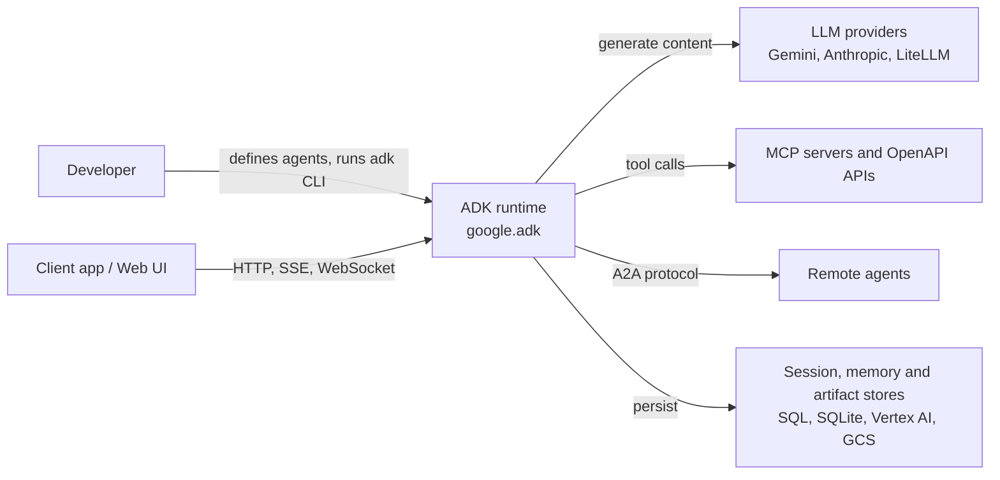

# 1. Overview

The Agent Development Kit (ADK, package `google-adk`) is an open-source, code-first Python toolkit for building, evaluating and deploying AI agents (`pyproject.toml:1-20`, `README.md`). Think of it as a workshop: you define a *worker* (an agent), give it *tools*, and a *runner* manages the shift: it keeps the logbook (session), records every action (events), and hands results back to you.

## System context (C4 level 1)

## Key concepts

| Concept | Meaning | Source |
|---|---|---|
| Agent | Blueprint of identity, instructions and tools | `src/google/adk/agents/base_agent.py:110`, `llm_agent.py:274` |
| Runner | Stateless engine that executes an invocation | `src/google/adk/runners.py:229` |
| Workflow / BaseNode (ADK 2.0) | Graph orchestration of nodes | `workflow/_workflow.py:134`, `workflow/_base_node.py:44` |
| Session | Conversation state and event history | `sessions/base_session_service.py:63` |
| Memory | Long-term recall across sessions | `memory/base_memory_service.py:44` |
| Tool | Capability an LLM can call | `tools/base_tool.py:57` |
| Event | Unit of output and state change | `events/event.py:87` |

## Value
ADK is model-agnostic and deployment-agnostic: the same agent code runs under `adk run`, `adk web`, an API server, Cloud Run, GKE or Agent Engine (`cli/cli_tools_click.py`). It ships with evaluation (`evaluation/`), observability (`telemetry/`) and plugins (`plugins/`).

## Repository layout
`src/google/adk/` holds ~30 packages (agents, workflow, flows, sessions, models, tools, cli, evaluation, integrations, a2a...). Tests are in `tests/`, samples in `contributing/`, guides in `docs/guides/`. See the other documents: [Architecture](2.Architecture.md), [Workflows](3.Workflows.md), [Boundaries](5.Boundaries-Interfaces.md), [Database](6.Database-Overview.md).
