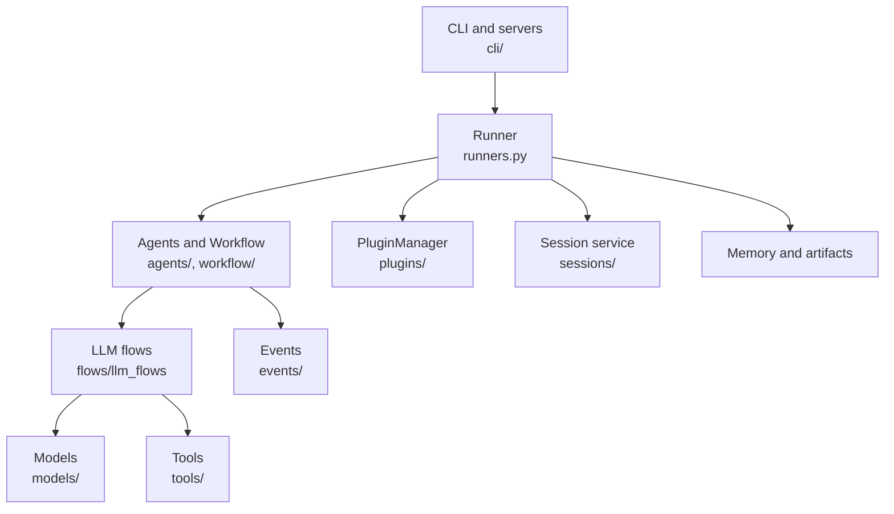

# 2. Architecture

ADK is layered like a restaurant: the *front of house* (CLI and HTTP servers) takes orders, the *runner* is the head waiter coordinating, *agents and workflow nodes* are the cooks, and *services* (sessions, memory, artifacts) are the pantry and order book. Services are abstract base classes with pluggable backends, so the kitchen never cares where the pantry lives.

## Containers (C4 level 2)

## Components

| Module | Responsibility | Key files / types |
|---|---|---|
| runner | Orchestrates invocations, persistence, compaction, resume | `runners.py:229` `Runner`, `:1142` `run_async`, `:1746` `run_live`, `:2393` `InMemoryRunner` |
| workflow | Graph of `BaseNode`s with retry, timeout, concurrency | `workflow/_workflow.py:134`, `_node_runner.py:52`, `_graph.py:96` |
| agents | LLM, Sequential, Parallel, Loop, remote A2A agents | `agents/llm_agent.py`, `sequential_agent.py`, `parallel_agent.py`, `loop_agent.py` |
| flows | Request/response processor pipeline around an LLM call | `flows/llm_flows/base_llm_flow.py:93`, `single_flow.py`, `auto_flow.py` |
| models | LLM abstraction and registry | `models/base_llm.py:36`, `google_llm.py`, `lite_llm.py`, `anthropic_llm.py` |
| tools | Function, MCP, OpenAPI, Google Cloud tools | `tools/base_tool.py:57`, `function_tool.py`, `mcp_tool/` |
| sessions | Session/state persistence | `sessions/database_session_service.py:310`, `sqlite_session_service.py:184` |
| plugins | Cross-cutting callbacks | `plugins/base_plugin.py:41`, `plugin_manager.py:62` |

## Patterns and decisions
- **Abstract service + backends**: `BaseSessionService`, `BaseMemoryService`, `BaseArtifactService` each have in-memory, local and cloud implementations. Trade-off: more classes, but swap storage without touching agents.
- **Agents are nodes**: `BaseAgent(BaseNode)` (`agents/base_agent.py:110`) unifies the older agent tree with the ADK 2.0 graph; `Workflow` can contain agents.
- **Event sourcing**: state changes travel as `Event` actions (`events/event.py:87`) and are applied by the session service, keeping the runner stateless.
- **Private-by-default**: modules prefixed `_` are internal (`workflow/_*.py`); only `__init__.py` exports are public API.
- **Pydantic models** underpin nodes, configs and events.
