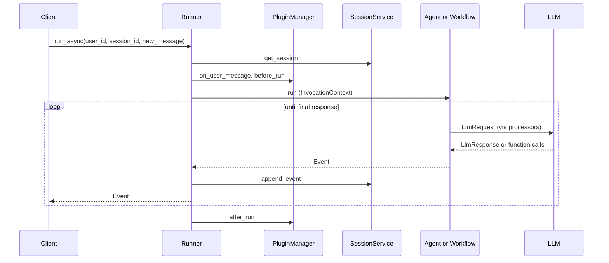
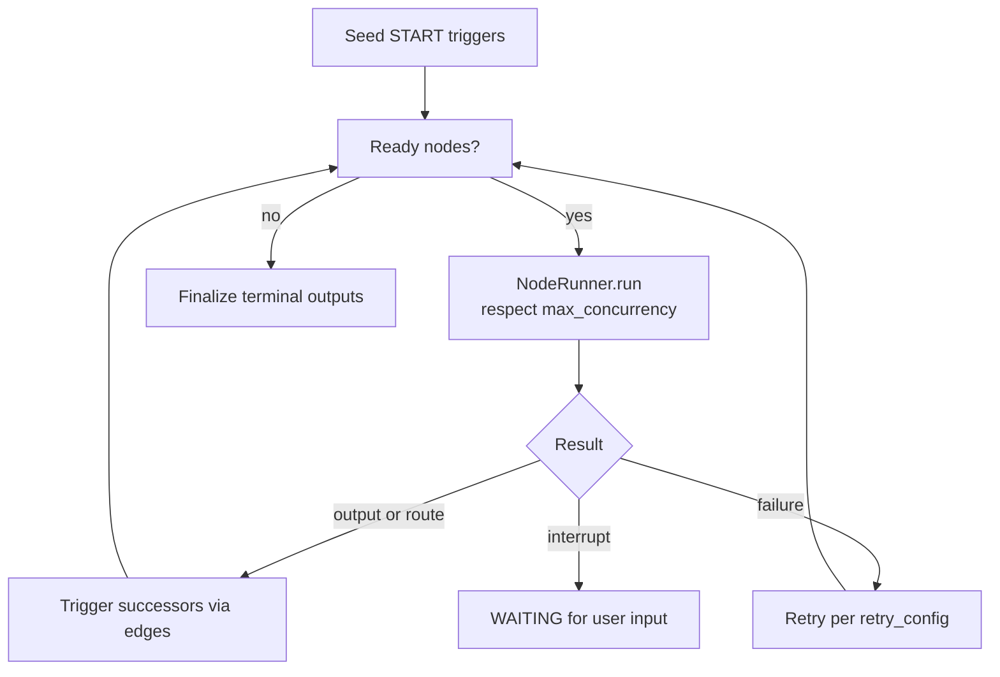

# 3. Workflows

This document follows a user message through ADK, then looks at how graph workflows schedule nodes, and how failures and human pauses are handled.

## Invocation lifecycle

`Runner.run_async` (`runners.py:1142`) loads the session, runs `on_user_message` plugins, appends the user message, builds an `InvocationContext`, runs the root node, and yields each `Event` while the session service persists it.

## LLM step
`BaseLlmFlow.run_async` (`flows/llm_flows/base_llm_flow.py:329`) loops `_run_one_step_async` (`:374`): preprocess (instructions, contents, identity, planning; `:448`), call the model with before/after model callbacks (`:605`), postprocess and execute function calls (`:483`, `:586`). It repeats until a final response. `auto_flow.py` adds agent transfer for sub-agents.

## Graph workflow
`Workflow._run_impl` (`workflow/_workflow.py`) is the loop: setup graph and seed triggers, schedule ready nodes through `NodeRunner` (`_node_runner.py:115`), react to completions, finalize outputs.

## Concurrency, errors, resume
- `max_concurrency` throttles graph-scheduled nodes only; dynamic `ctx.run_node()` children are excluded to avoid deadlock (`_workflow.py:150`).
- `retry_config` and `timeout` on `BaseNode` (`_base_node.py`) retry failed or timed-out nodes (`NodeTimeoutError`); `_attempt_retry` is at `_node_runner.py:188`.
- `rerun_on_resume` decides whether an interrupted node reruns or completes with the user's reply; `Workflow` defaults to rerun. `wait_for_output` lets `JoinNode` wait for several predecessors (`_join_node.py`).
- Plugins provide error hooks (`on_model_error_callback`, `on_tool_error_callback`, `on_run_error_callback`; `plugins/base_plugin.py:272-394`).
