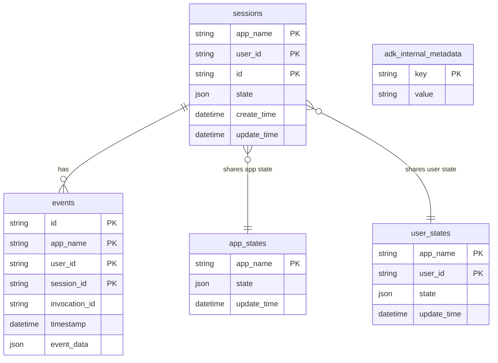

# 6. Database Overview

ADK stores conversations in a relational database when `DatabaseSessionService` (`sessions/database_session_service.py:310`, SQLAlchemy) or `SqliteSessionService` (`sessions/sqlite_session_service.py:184`) is used. The current ORM schema is `sessions/schemas/v1.py`; `v0.py` is the legacy layout and `sessions/migration/` plus `adk migrate session` upgrade between them. Event bodies are stored as a JSON blob, which keeps the schema stable while the `Event` model evolves.

| Table | Class | Line (`schemas/v1.py`) |
|---|---|---|
| `adk_internal_metadata` | `StorageMetadata` | 56-64 |
| `sessions` | `StorageSession` | 71-74 |
| `events` | `StorageEvent` | 163-166 |
| `app_states` | `StorageAppState` | 244-247 |
| `user_states` | `StorageUserState` | 260-263 |

State scoping: keys prefixed `app:` go to `app_states`, `user:` to `user_states`, `temp:` are never persisted, and unprefixed keys live in `sessions.state` (`sessions/state.py`). Other persistence: `SqliteMemoryService` (`memory/_sqlite_memory_service.py:147`) for memory; in-memory, Vertex AI and GCS/file backends for artifacts and sessions.
